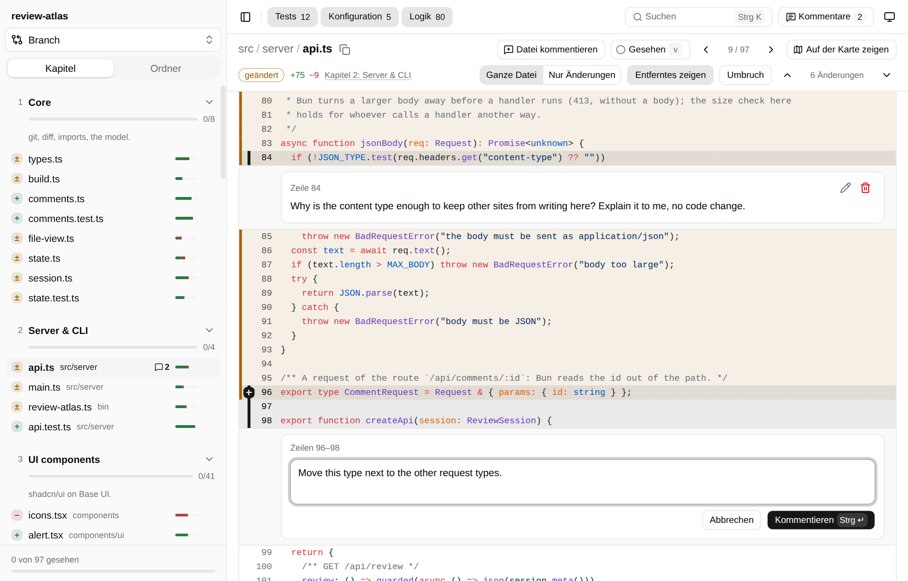
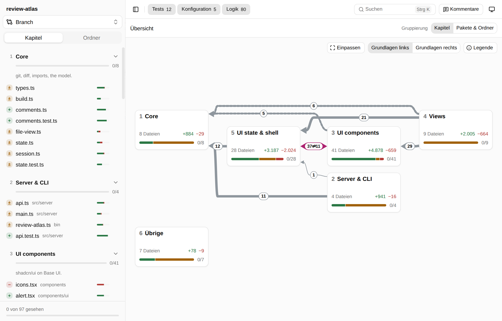
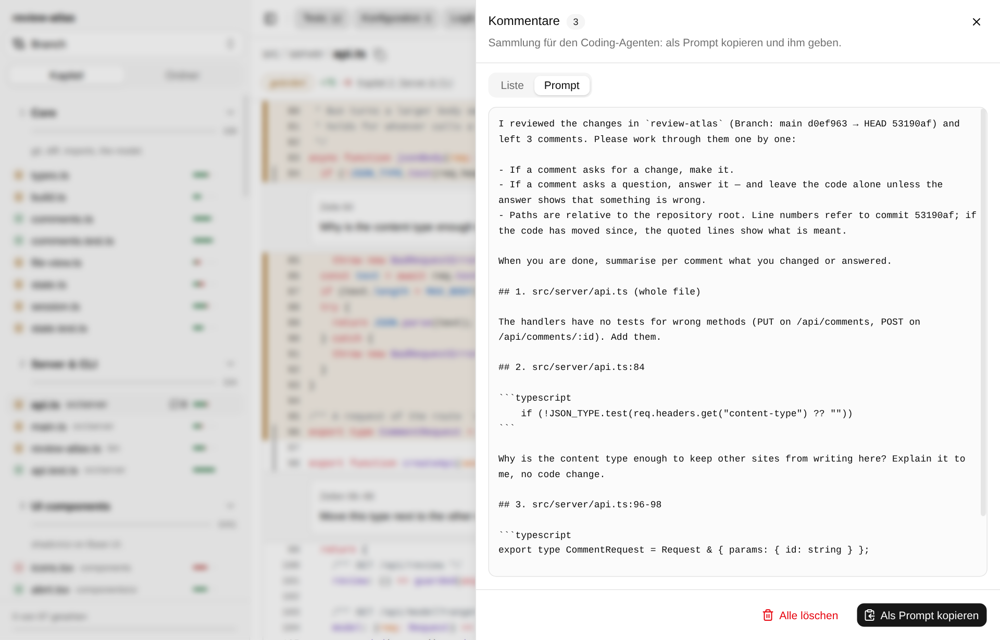

# review-atlas

Review the changes of a git branch in the browser: a **map** of the changed files and how they
import each other, and a **reader** that shows each file with its changed lines marked. Comment on
lines or whole files while you read, then copy all comments as one prompt for your coding agent.



It reads the repository only through `git` — the two commits of a range, never the working tree —
so any branch can be reviewed without checking it out. The interface is in German.

## Quick start

You need [Bun](https://bun.sh) (developed with 1.4) and git 2.40 or newer.

```sh
bun install
mkdir -p reviews/local
cp reviews/example.review.ts reviews/local/my-branch.review.ts   # then edit it, see below
bun run atlas:check reviews/local/my-branch.review.ts            # is the review file sane? (no server)
bun run atlas reviews/local/my-branch.review.ts --open           # http://127.0.0.1:4610
```

In the copy, change the import to `../../src/core/define` (it lies one directory deeper) and
point `repo` at your checkout. `reviews/local/` is git-ignored, so the review of a private
repository stays out of this one.

## The review file

One file says what to review: the repository, one or more ranges, and — if you like — chapters
that put the files into a reading order.

```ts
// reviews/local/my-branch.review.ts
import { defineReview } from "../../src/core/define";

export default defineReview({
	id: "my-feature", // slug; names the files your marks and comments are kept in
	title: "My feature",
	repo: "/path/to/repo", // absolute, or relative to this file
	ranges: [
		// the first is the default; `mergeBase` compares with the point the branch left `main`
		{ id: "branch", label: "Whole branch", base: "main", mergeBase: true },
		{ id: "last", label: "Last commit", base: "HEAD~1" },
	],

	// everything below is optional
	excludeCategories: ["test", "migration", "generated", "asset"], // never part of the review
	defaultCategories: ["logic"], // visible when the page opens; the rest is one click away
	categories: [{ category: "test", match: ["**/testing.ts"] }], // checked before the built-in rules
	exclude: ["vendor/**"],
	chapters: [
		// in reading order; the first match wins; what matches none lands in a last chapter
		{ id: "core", title: "Core", summary: "What the rest builds on.", match: ["packages/core/**"] },
		{ id: "web", title: "Web", match: ["apps/web/**"] },
	],
});
```

- `base` and `head` take any git revision; `head` defaults to `HEAD`.
- Globs are anchored at the repository root: `**` spans directories, `*` and `?` stay inside one
  segment, `{a,b}` gives alternatives. `*.md` is a root file, `**/*.md` any depth.
- `atlas:check` prints what the review holds (files per category and chapter, import cycles) and
  exits 1 when an import does not resolve. List the ones you know about in `expectedUnresolved`.

Every changed file gets a category; the first rule that matches wins:

| id          | default rule                                                                                                    |
| ----------- | --------------------------------------------------------------------------------------------------------------- |
| `generated` | lockfiles, `*.snap`, `*.gen.*`, `*.generated.*`, `*.min.{js,css}`, source maps                                  |
| `migration` | `**/drizzle/**`, `**/migrations/**`                                                                             |
| `docs`      | `*.md`, `*.mdx`, `docs/**`                                                                                      |
| `test`      | `*.test.*`, `*.spec.*`, `*.testing.*`, `__tests__/`, `test/`, `tests/`, `testing/`, `fixtures/`, `e2e/`         |
| `locale`    | `**/locales/**`, `**/i18n/**/*.json`                                                                            |
| `asset`     | images, fonts, media, archives, and any binary file                                                             |
| `config`    | `package.json`, `tsconfig*.json`, `*.config.*`, dotfiles, YAML/TOML/INI, `Dockerfile*`, `helm/**`, `.github/**` |
| `logic`     | every remaining source file                                                                                     |
| `other`     | everything else                                                                                                 |

## Reviewing

**The map** starts with the chapters (or packages and folders) and what imports what between
them; a click goes one level down, until the nodes are files. An arrow from A to B means A imports
B, the number says how often; dashed lines are type-only imports, magenta ones are cycles.



**A file** opens with its changed lines marked (and, if you want, the removed lines above them),
what it imports and what imports it, and a button to mark it as seen. "Nur Änderungen" folds
everything else away.

**Comments** are how you tell your agent what to do:

1. Hover a line and click the **+** next to its number; drag over several lines for a range. For
   the file as a whole: "Datei kommentieren".
2. Write what should happen there — a change to make or a question to answer.
3. Open **Kommentare** in the header and press **Als Prompt kopieren**. The prompt names every
   comment as `path:line` with the commented lines quoted, in reading order; paste it into your
   agent.



Comments and "seen" marks are kept in `.review-atlas/` inside this directory and survive a
restart. When the branch gets new commits, files that changed since count as not seen again, and
a comment whose lines changed says so.

| Key             | Does                                            |
| --------------- | ----------------------------------------------- |
| Ctrl/Cmd-K, `/` | search the files                                |
| `j` / `k`       | next / previous file in reading order           |
| `n` / `p`       | next / previous change in the file              |
| `v`             | mark the file as seen                           |
| `c`             | comment the file (or the line a link points to) |
| Ctrl/Cmd-Enter  | save the comment you are writing                |
| Ctrl/Cmd-B      | show or hide the sidebar                        |

## Commands

```
bun run atlas <review-file> [--port 4610] [--host 127.0.0.1] [--range <id>] [--open] [--dev]
bun run atlas:check <review-file> [--range <id>] [--cold]
```

`--open` opens the browser, `--range` picks another range than the first, `--dev` is for working
on the tool itself (the page follows changes to its code). `atlas:check --cold` builds without
the import cache.

## Working on the tool

`bun test`, `bun run typecheck`, `bun run check` (Biome). How it is built — the layers, the HTTP
contract, how to add a language, a resolver or a page — is in
[docs/architecture.md](docs/architecture.md).
